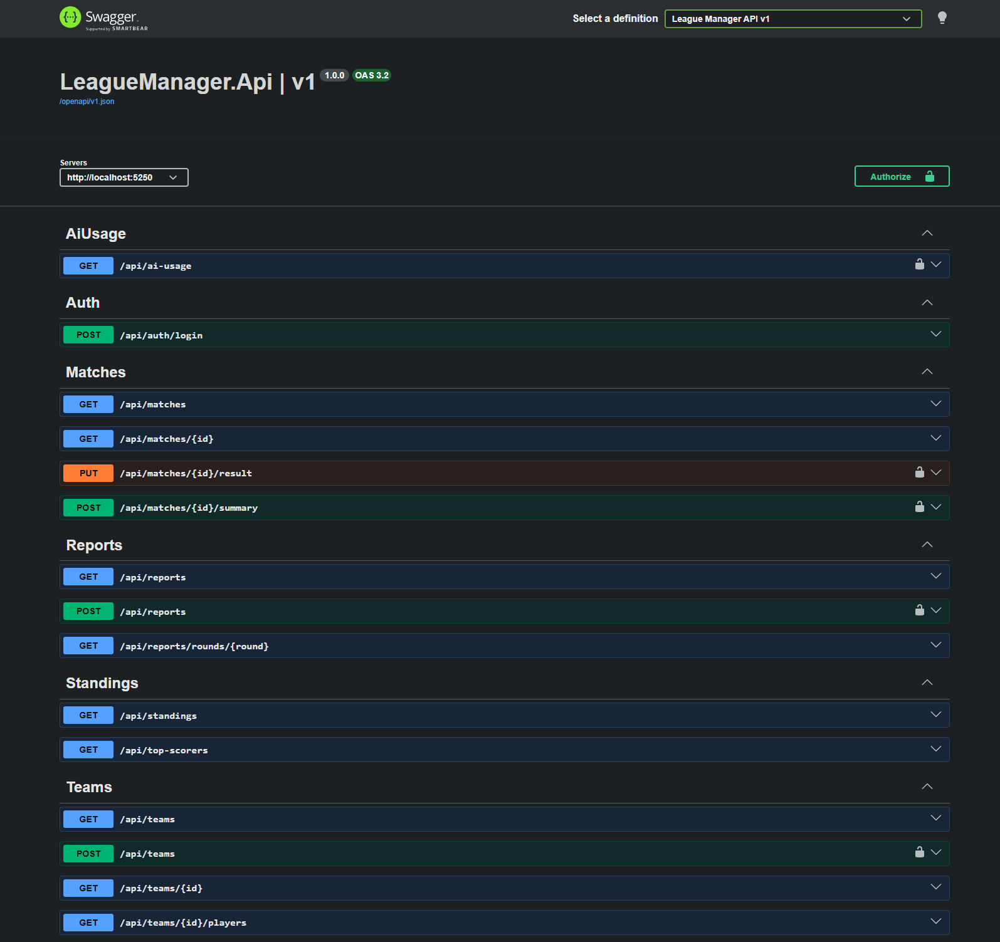
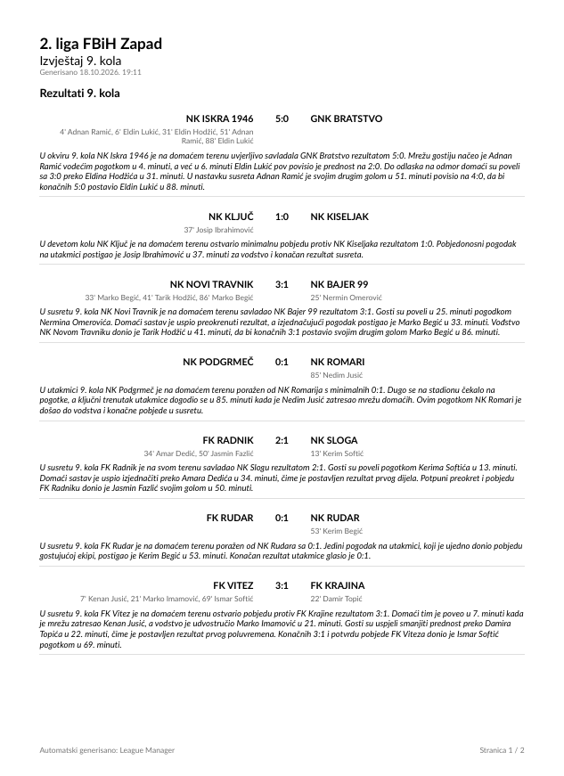
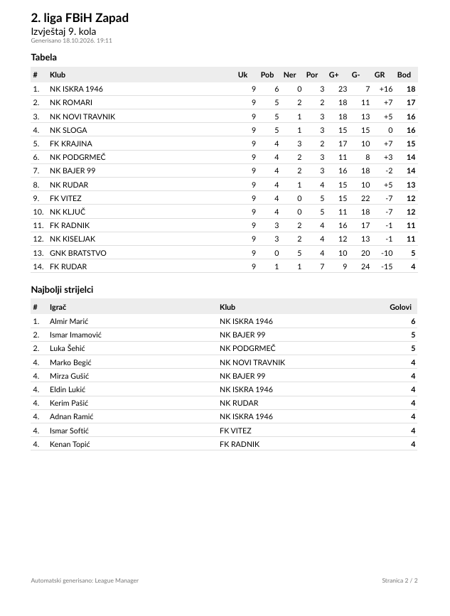

# League Manager

A backend for lower football leagues, built for a real use case: **2. liga FBiH Zapad** (Bosnia and Herzegovina).

**The problem:** after every round, the people who publish results on fan pages update the table and the top scorers by hand and post them on Facebook, which takes 1 to 2 hours or more per round.
**The 10x idea:** the admin only enters the results and scorers. The table, the top scorers, a written match summary (in Bosnian) and a weekly round PDF are produced automatically.

## Screenshots


*Swagger UI: public read endpoints and admin endpoints (lock icon) protected by JWT.*


*Round PDF, page 1: results with dates, scorers and the AI-generated match reports in Bosnian.*


*Round PDF, page 2: the standings table and top scorers after that round.*

## Features

1. **Admin login** with JWT and an admin role. Everyone else has read-only access.
2. **Teams and fixtures by round**, seeded with the real 2026/2027 fixtures.
3. **Results with scorers**, from which the **standings table** and **top scorers** are calculated (cached, invalidated on every change).
4. **Weekly round report as PDF**, generated automatically every Monday at 08:00 (Sarajevo time).
5. **AI match summary** in Bosnian, generated by Gemini from the result and scorers and validated before it is stored.

Out of scope: live scores, player registration and payments, a mobile app, scraping.

## Tech stack

.NET 11 (RC), ASP.NET Core controllers, EF Core with SQLite, Clean Architecture with own CQRS handlers (no MediatR), JWT bearer auth, `IMemoryCache`, `BackgroundService`, QuestPDF (Community license), Google Gemini API (free tier), xUnit. Total cost: $0.

## Run it

Prerequisite: [.NET SDK 11.0.100-rc.2](https://dotnet.microsoft.com/download/dotnet/11.0) or later.

```bash
git clone https://github.com/mehocatic/league-manager.git
cd league-manager
dotnet run --project src/LeagueManager.Api
```

That is all. On the first start the app creates `league.db`, applies the migrations, seeds the league data and opens Swagger UI at <http://localhost:5250/swagger>.

The console prints the generated admin password **once**:

```
warn: DatabaseInitializer[0]
      Admin password: 7kQmP3...
```

Log in as `admin` with it. Lost it? Stop the app, delete `src/LeagueManager.Api/league.db` and start again.

### Optional: AI summaries

Everything works without a Gemini key, except generating match summaries (that endpoint answers 503 with setup instructions, and the PDF is produced without summaries). To enable them, get a free key at [Google AI Studio](https://aistudio.google.com/apikey) and run:

```bash
dotnet user-secrets set "Gemini:ApiKey" "<your-key>" --project src/LeagueManager.Api
```

### Tests

```bash
dotnet test
```

53 tests, no network or API key needed (Gemini is replaced by fakes). The key one compares the calculated table with the **official table after round 9**, row by row.

## Configuration and secrets

No secret is committed to Git. Secrets come from `dotnet user-secrets` (development) or environment variables (any environment; `__` replaces `:`).

| Setting | Where | Notes |
|---|---|---|
| `Admin:Password` | user-secrets or `Admin__Password` | Only used to create the first admin when the `Users` table is empty. In Development, if it is missing, a random password is generated and printed once. Changing it later does not change the stored password. |
| `Gemini:ApiKey` | user-secrets or `Gemini__ApiKey` | Optional, see above. |
| `Jwt:SigningKey` | user-secrets or `Jwt__SigningKey` | At least 32 bytes. In Development a random key is generated per start (tokens stop working after a restart). Outside Development the app refuses to start without it. |
| `Gemini:Model`, `Gemini:ThinkingLevel`, prices | `appsettings.json` | `gemini-3.8-flash` with thinking level `low`. |
| `Reports:*` | `appsettings.json` | League name, schedule (Monday 08:00, `Europe/Sarajevo`), on/off switch. |

## Seed and demo data

- `data/teams.csv` and `data/fixtures.csv`: the **real** 14 clubs and the fixtures of 2. liga FBiH Zapad 2026/2027, rounds 1 to 13. Rounds 1 to 9 are played, rounds 10 to 13 are scheduled. Source: the public pages of the Football Association of FBiH (see [data/README.md](data/README.md)).
- `data/official-standings-after-round-9.csv`: the official table, used by the test.
- **Players and scorers are fictional** (18 per team, generated with a fixed random seed, so every machine gets the same names). The number of goals per team always matches the real results.
- The seeder runs only on an empty database. To reset, delete `league.db`.

## 5-minute demo

All steps in Swagger UI (<http://localhost:5250/swagger>).

1. **Start** with `dotnet run --project src/LeagueManager.Api` and copy the admin password from the console.
2. **Table:** `GET /api/standings` shows the table after round 9, identical to the official one. The console logs `Standings cache miss` only for the first request; repeat it and nothing is logged (served from memory).
3. **Log in:** `POST /api/auth/login` with `{"username": "admin", "password": "<from console>"}`, copy `token`, click **Authorize** and paste it.
4. **Find the match:** `GET /api/matches?round=10`. The first one is match `64`, FK Krajina vs GNK Bratstvo (team ids 5 and 13). `GET /api/teams/5/players` and `GET /api/teams/13/players` list the squads.
5. **Enter the result:** `PUT /api/matches/64/result`
   ```json
   { "homeGoals": 2, "awayGoals": 1,
     "goals": [ { "playerId": 89, "minute": 23 }, { "playerId": 221, "minute": 51 }, { "playerId": 87, "minute": 77 } ] }
   ```
   Try a wrong body too (two scorers for a 2:1, or a player from another team): you get a 400 with a clear message.
6. **Table updated:** `GET /api/standings` again. FK Krajina moves from 5th to 2nd. The cache was invalidated by the result.
7. **AI summary** (needs the Gemini key): `POST /api/matches/64/summary` returns a Bosnian match report.
8. **Round PDF:** `POST /api/reports` (generates the report for the latest played round, round 10, and fills in missing summaries), then `GET /api/reports/rounds/10` and download the PDF.
9. **AI cost log:** `GET /api/ai-usage` shows every Gemini call with tokens, duration and what it would cost on the paid tier.

## Concept to code

| Concept | Where it lives |
|---|---|
| **API endpoints** | [src/LeagueManager.Api/Controllers](src/LeagueManager.Api/Controllers), thin controllers calling one CQRS handler each. Handlers: [src/LeagueManager.Application](src/LeagueManager.Application) (`Teams/`, `Matches/`, `Standings/`, `Reports/`, `Auth/`, `AiUsage/`). Own CQRS interfaces: [Abstractions/IQuery.cs](src/LeagueManager.Application/Abstractions/IQuery.cs), [Abstractions/ICommand.cs](src/LeagueManager.Application/Abstractions/ICommand.cs). Errors become RFC 9457 ProblemDetails in [ApiController.cs](src/LeagueManager.Api/Controllers/ApiController.cs). |
| **Database** | [LeagueDbContext.cs](src/LeagueManager.Infrastructure/Persistence/LeagueDbContext.cs), rules in [Configurations/](src/LeagueManager.Infrastructure/Persistence/Configurations) (no attributes on Domain entities), [Migrations/](src/LeagueManager.Infrastructure/Persistence/Migrations) applied on startup by [DatabaseInitializer.cs](src/LeagueManager.Infrastructure/Persistence/DatabaseInitializer.cs), seed in [Seed/LeagueSeeder.cs](src/LeagueManager.Infrastructure/Persistence/Seed/LeagueSeeder.cs). |
| **Authentication** | [AuthenticationSetup.cs](src/LeagueManager.Api/Authentication/AuthenticationSetup.cs) (JWT validation, login rate limit), [Auth/Login.cs](src/LeagueManager.Application/Auth/Login.cs), [JwtTokenIssuer.cs](src/LeagueManager.Infrastructure/Authentication/JwtTokenIssuer.cs), [IdentityPasswordHasher.cs](src/LeagueManager.Infrastructure/Authentication/IdentityPasswordHasher.cs) (PBKDF2), [AdminSeeder.cs](src/LeagueManager.Infrastructure/Persistence/Seed/AdminSeeder.cs). Write endpoints use `[Authorize(Roles = Roles.Admin)]`. |
| **Background job (cron)** | [WeeklyReportJob.cs](src/LeagueManager.Api/BackgroundJobs/WeeklyReportJob.cs) (`BackgroundService`), schedule in [WeeklySchedule.cs](src/LeagueManager.Application/Reports/WeeklySchedule.cs) (Monday 08:00 Sarajevo time, summer/winter time aware). |
| **PDF reporting** | [GenerateRoundReport.cs](src/LeagueManager.Application/Reports/GenerateRoundReport.cs) (data, missing summaries, storage), [QuestPdfRoundReportRenderer.cs](src/LeagueManager.Infrastructure/Reports/QuestPdfRoundReportRenderer.cs) (layout). |
| **Caching** | [StandingsCache.cs](src/LeagueManager.Application/Standings/StandingsCache.cs), used in [GetStandings.cs](src/LeagueManager.Application/Standings/GetStandings.cs) and [GetTopScorers.cs](src/LeagueManager.Application/Standings/GetTopScorers.cs), invalidated in [EnterResult.cs](src/LeagueManager.Application/Matches/EnterResult.cs) and [CreateTeam.cs](src/LeagueManager.Application/Teams/CreateTeam.cs). |
| **LLM integration** | [GeminiClient.cs](src/LeagueManager.Infrastructure/Ai/GeminiClient.cs) (HTTP, rate-limit retry, usage log), [MatchSummaryPrompt.cs](src/LeagueManager.Application/Matches/MatchSummaryPrompt.cs) (input), [MatchSummaryValidator.cs](src/LeagueManager.Application/Matches/MatchSummaryValidator.cs) (output), [GenerateMatchSummary.cs](src/LeagueManager.Application/Matches/GenerateMatchSummary.cs), cost log in [GetAiUsage.cs](src/LeagueManager.Application/AiUsage/GetAiUsage.cs). |

The standings rules themselves (points, tie-breakers) are pure Domain code in [StandingsCalculator.cs](src/LeagueManager.Domain/Standings/StandingsCalculator.cs).

## API

| Method and route | Access | Purpose |
|---|---|---|
| `GET /api/teams`, `/api/teams/{id}`, `/api/teams/{id}/players` | public | Teams and squads |
| `GET /api/matches?round=`, `/api/matches/{id}` | public | Fixtures and match details with scorers and summary |
| `GET /api/standings`, `/api/top-scorers?limit=` | public | Table and top scorers (cached) |
| `GET /api/reports`, `/api/reports/rounds/{round}` | public | List of round PDFs, download |
| `POST /api/auth/login` | public, 5 per minute per IP | Returns a JWT |
| `POST /api/teams` | admin | Create a team |
| `PUT /api/matches/{id}/result` | admin | Enter or correct a result with scorers |
| `POST /api/matches/{id}/summary` | admin | Generate the AI summary |
| `POST /api/reports?round=` | admin | Generate a round PDF now (default: latest played round) |
| `GET /api/ai-usage` | admin | AI calls, tokens and estimated cost |

## Architecture

```
src/
  LeagueManager.Domain           entities, standings rules (no dependencies)
  LeagueManager.Application      use cases (CQRS handlers), validation, interfaces  -> Domain
  LeagueManager.Infrastructure   EF Core/SQLite, Gemini, QuestPDF, JWT, hashing      -> Application
  LeagueManager.Api              controllers, auth setup, background job, Swagger   -> Application, Infrastructure
tests/
  LeagueManager.Tests            xUnit, runs the real DI setup on a temporary SQLite file
```

Handlers return `Result<T>` for expected failures (validation, not found, conflict) instead of throwing; the API maps them to 400/404/409/401/503 in one place.

## How the AI summary is kept honest

The model only sees facts from the database, sent as JSON: teams, final score, and every goal with minute, scorer and the score after that goal. Its answer is treated as untrusted input and stored only if it:

- names both clubs and every scorer (Bosnian case endings such as "FK Viteza" or "Jusića" are accepted; prefixes like NK/FK and numbers like 1946 must match exactly),
- states the exact final score,
- mentions every goal minute in the order the goals were scored (this stops "the final goal" being attached to the wrong goal),
- has a sensible length and no links or markdown.

A rejected answer gets one retry; after that the summary is left empty rather than wrong. Every call, successful or not, is stored with tokens, duration and estimated cost.

## Known limitations

- The validator checks facts, not grammar or wording. An occasional language slip can still pass.
- Own goals are not supported: every scorer must play for the team credited with the goal.
- On the Gemini free tier `gemini-3.8-flash` allows 5 requests per minute. A full round (7 summaries) therefore waits once or twice and takes around 30 to 60 seconds.
- If the app is not running on Monday at 08:00, that run is not caught up automatically; the admin can call `POST /api/reports`.
- Single instance by design: SQLite and an in-memory cache. A second API instance would need a shared database and a distributed cache.
- A front end (Angular: public table and fixtures, admin panel) is planned but not part of this repository yet.

## How AI was used

I designed the project, made the architecture and product decisions, and verified every step (build, tests, live API checks, comparing the table with the official one). Claude (an AI assistant) wrote most of the code under my direction. I reviewed each change before committing it and can explain every part of the system.
